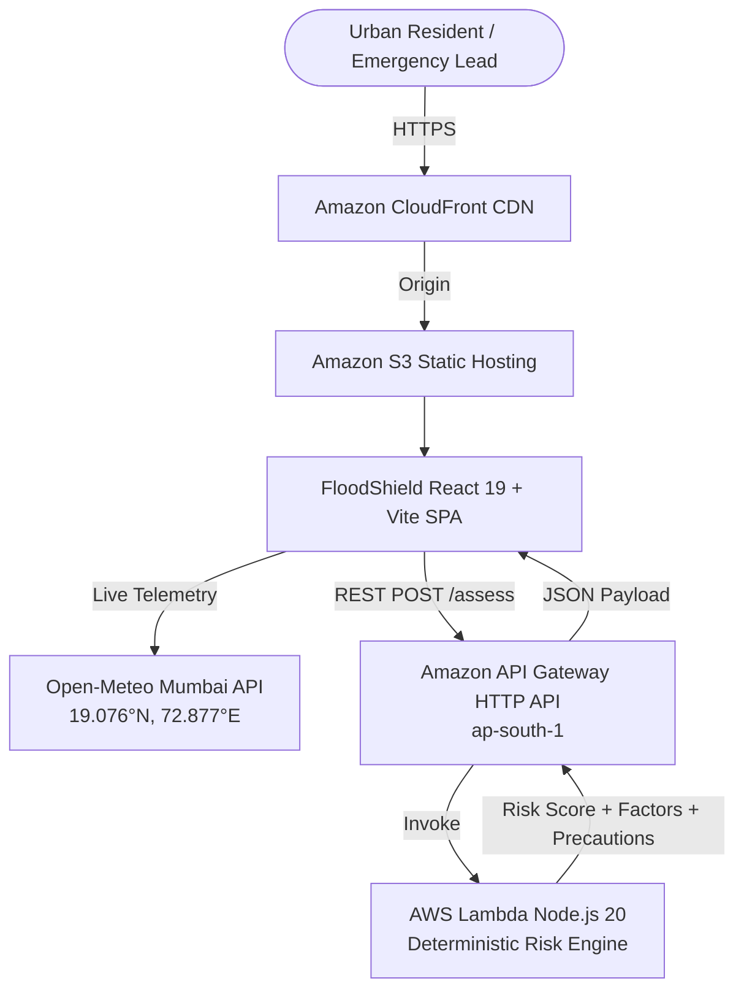

# 🌊 FloodShield — Monsoon Intelligence for Indian Cities

> **"Don't just show people the weather. Help them understand localized risk and decide what to do next."**

[](#)
[](#)
[-F59E0B?style=flat-square)](#)
[](#)

---

## 📌 Executive Summary

Urban waterlogging paralyzes Mumbai every monsoon. When intense rainfall coincides with Arabian Sea high tides (>4.5m), the Brihanmumbai Municipal Corporation (BMC) storm gates close to prevent seawater ingress, trapping stormwater in low-lying saucer basins (such as Hindmata, Milan Subway, Kurla, and Andheri Subway).

**FloodShield** is a climate-intelligence console built for urban residents, transit commuters, and municipal emergency-response coordinators. Rather than displaying passive rain forecasts, FloodShield evaluates localized topographical depressions, tidal gate mechanics, and runoff coefficients to deliver **actionable risk scores and specific precautionary directives**.

---

## 🏗️ System Architecture



### Components
1. **Frontend**: React 19, TypeScript, Tailwind CSS v4, Leaflet with CartoDB Dark Matter tiles, Lucide icons.
2. **Backend**: AWS Lambda (Node.js 20, arm64 Graviton) running in Mumbai (`ap-south-1`).
3. **API Gateway**: Amazon API Gateway HTTP API with low-latency CORS handling.
4. **Local Fallback & Dev Harness**: Embedded local Lambda emulator (`npm run api:dev` on port 5001) for seamless development and transparent fallback when offline.
5. **Weather Telemetry**: Real-time Open-Meteo API integration with zero API-key requirement and graceful offline handling.

---

## 🧮 Deterministic Heuristic Risk Engine

FloodShield does **not** make scientifically unverified hydrodynamic claims. It computes a transparent, normalized susceptibility score ($0 - 100$) derived from four municipal engineering benchmarks:

$$\text{Risk Score} = \min(100, P_{\text{load}} + T_{\text{topo}} + H_{\text{tide}} + R_{\text{runoff}})$$

### Factor Breakdown

| Component | Max Points | Physics & Municipal Logic |
| :--- | :---: | :--- |
| **Precipitation Load ($P_{\text{load}}$)** | **40** | BMC historic drainage design benchmark is ~25–50 mm/h. Rain intensity exceeding 60 mm/h saturates culverts exponentially with duration accumulation. |
| **Topographical Vulnerability ($T_{\text{topo}}$)** | **25** | Evaluates localized depression index (1–10) and elevation (m). Deep saucer depressions (e.g. Milan Subway underpass) pool water swiftly; mitigated by BMC underground rainwater holding tanks. |
| **Hydraulic & Tidal Resistance ($H_{\text{tide}}$)** | **20** | When Arabian Sea tides exceed 4.5m, gravity discharge gates close, stalling Mithi river and stormwater outfalls. Silted culverts exacerbate resistance. |
| **Surface Runoff ($R_{\text{runoff}}$)** | **15** | Dense impervious asphalt and concrete coverage produces immediate sheet runoff without ground percolation. |

### Classification Bands
- 🟢 **LOW RISK (0 – 39)**: Normal vehicular transit permitted; monitor municipal weather alerts.
- 🟡 **MODERATE RISK (40 – 69)**: Slow vehicle speeds; underpasses may experience intermittent water ponding.
- 🔴 **HIGH RISK (70 – 100)**: Avoid underpass corridors; relocate vehicles to elevated podium decks; outfall gates locked.

---

## 📍 Grounded Mumbai Locations

FloodShield includes authentic, coordinate-accurate profiles for primary flood hotspots across Mumbai:

1. **Hindmata, Dadar (F/South Ward)** — `[19.0144, 72.8428]`: Saucer depression; equipped with modern BMC underground holding tank.
2. **Milan Subway, Santacruz (H/East Ward)** — `[19.0831, 72.8442]`: Critical railway underpass dip (Depression 10/10); flash inundation hotspot.
3. **Kurla West / Mithi River Basin (L Ward)** — `[19.0726, 72.8797]`: Adjacent to Mithi River channel (150m); high tide swell creates rapid backflow.
4. **Andheri Subway (K/East Ward)** — `[19.1197, 72.8464]`: Vital suburban arterial underpass; prone to stormwater trapping from SV Road.
5. **King's Circle / Gandhi Market (F/North Ward)** — `[19.0328, 72.8570]`: Old tidal swamp basin with saturated water table.
6. **Bandra-Kurla Complex (H/East Ward)** — `[19.0660, 72.8680]`: Commercial estuary zone equipped with high-capacity storm pumps.
7. **Marine Drive (A Ward)** — `[18.9220, 72.8228]`: Coastal boulevard with rapid gravity outflow; surge overtopping risk during spring tides.
8. **Amar Mahal, Chembur (M/West Ward)** — `[19.0625, 72.8988]`: Eastern Express highway intersection; Mahul creek backwater risk.

---

## ⚡ Quick Start (Local Development)

### 1. Install Dependencies
```bash
npm install
```

### 2. Run Risk Engine Unit Tests
```bash
npm test
```
All 9 unit tests verify deterministic bounding, tidal resistance escalation, and Lambda handler routing.

### 3. Launch Development Servers
Start both the Vite dev server and the local Lambda emulator:

```bash
# Terminal 1: Local Lambda API Emulator (Port 5001)
npm run api:dev

# Terminal 2: React Frontend (Port 5173)
npm run dev
```

Visit `http://localhost:5173` in your browser.

---

## ☁️ AWS Deployment (`ap-south-1`)

FloodShield is ready for immediate deployment to AWS in Mumbai (`ap-south-1`) via AWS SAM or CloudFormation:

```bash
# Deploy with AWS SAM
cd infra
sam build
sam deploy --guided
```

Or execute the included deploy script:
```bash
./infra/deploy.sh
```

To connect the deployed frontend to your live AWS API Gateway:
```bash
echo "VITE_AWS_API_URL=https://your-api-id.execute-api.ap-south-1.amazonaws.com" > .env
npm run build
```

---

## 🤝 Environmental Data Integrity & Trust Principles
- **No Fabricated Live Sensors**: FloodShield explicitly identifies that localized overlays are heuristic scenario models, not hydrodynamic telemetry sensors.
- **Transparent Provenance**: Every risk calculation clearly labels its execution engine (`AWS Lambda ap-south-1` vs `Local Heuristic Engine`) and execution latency.
- **Genuine Open Weather**: Real-time atmospheric observations are fetched directly from Open-Meteo with transparent timestamping.
