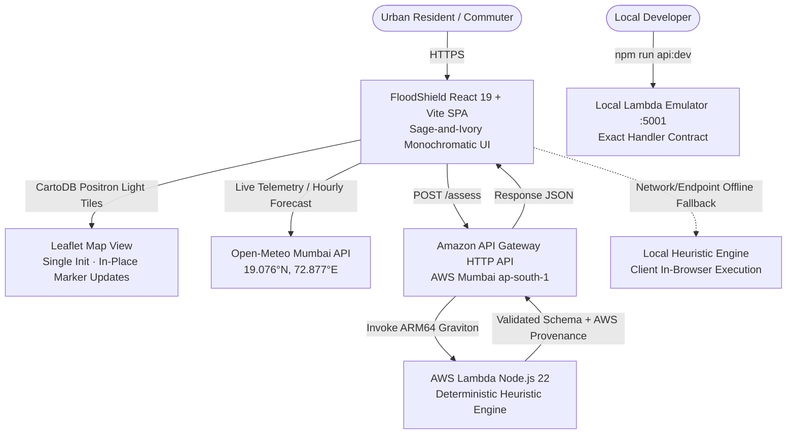

# 🌊 FloodShield — Monsoon Intelligence for Indian Cities

> **"Don't just show people the weather. Help them understand localized risk and decide what to do next."**

[](#)
[](#)
[-E5EBDD?style=flat-square&logoColor=344638)](#)
[](#)
[](#)

---

## 📌 Executive Summary

Urban waterlogging paralyzes Mumbai during severe monsoon downpours. When cloudburst or heavy rainfall coincides with Arabian Sea high tides (>4.5m), the Brihanmumbai Municipal Corporation (BMC) storm gates close to prevent tidal seawater ingress into the storm network. This hydraulic lock traps surface runoff in saucer-shaped topographical depressions across Mumbai (such as Hindmata, Milan Subway, Kurla, and Andheri Subway).

**FloodShield** is an environmental risk-intelligence web application built for urban residents, transit commuters, and municipal emergency coordinators. Rather than displaying passive rain forecasts or making unsubstantiated flood boundary claims, FloodShield calculates localized topographical depressions, tidal gate mechanics, and runoff coefficients to deliver **explainable risk scores, factor breakdowns, and actionable precautions**.

---

## 🏗️ System Architecture



### Architectural Highlights
1. **Frontend**: React 19, TypeScript, Tailwind CSS, Leaflet with CartoDB Positron light-theme tiles, Lucide icons.
2. **Visual System**: Soothing monochromatic sage-and-ivory palette (`#F7F8F4`, `#FFFFFF`, `#E5EBDD`, `#45664F`, `#344638`, `#737F71`, `#DDE3D8`, `#C87868`).
3. **Map Performance**: Leaflet map instance is initialized once on mount; markers and popups are updated in place without full layer recreation; camera flyTo animations are restricted strictly to user-initiated location selection.
4. **Backend**: AWS Serverless SAM template configured for **Node.js 22 (`nodejs22.x`)** on ARM64 Graviton in Mumbai (`ap-south-1`).
5. **API Gateway & CORS**: HTTP API Gateway with preflight OPTIONS handling and strict input validation.
6. **Local Development Harness**: Local Node.js server (`backend/local-server.js` on port 5001) executing the exact Lambda handler file for zero-cloud offline development.
7. **Weather Telemetry & Workflow**: Open-Meteo live observation service returning explicit source status metadata (`LIVE`, `SAMPLE_FALLBACK`, `UNAVAILABLE`) with direct transfer to the What-If Storm Simulator.

---

## 🧮 Deterministic Heuristic Risk Engine

FloodShield does **not** claim to provide calibrated hydrodynamic flood simulations, live flood boundaries, or guaranteed safe evacuation routes. It evaluates scenario-based susceptibility ($0 - 100$) derived from Mumbai municipal drainage engineering benchmarks:

$$\text{Risk Score} = \min(100, P_{\text{load}} + T_{\text{topo}} + H_{\text{tide}} + R_{\text{runoff}})$$

### Factor Breakdown

| Component | Max Points | Engineering & Empirical Basis |
| :--- | :---: | :--- |
| **Precipitation Load ($P_{\text{load}}$)** | **40** | Calibrated against BMC BRIMSTOWAD design benchmarks (25–50 mm/h standard drainage capacity). Precipitation exceeding 60 mm/h scales exponentially with duration accumulation. |
| **Topographical Vulnerability ($T_{\text{topo}}$)** | **25** | Evaluates localized depression index (1–10) and elevation (m). Low-lying saucers (e.g., Milan Subway, Hindmata) accumulate runoff rapidly; discounted by BMC underground holding tank storage during moderate rain. |
| **Hydraulic & Tidal Resistance ($H_{\text{tide}}$)** | **20** | Derived from the Chitale Committee (2006) findings on Mumbai coastal stormwater backflow: when Arabian Sea spring tides exceed 4.5m, gravity outfall floodgates close, stalling gravity drainage. |
| **Surface Runoff ($R_{\text{runoff}}$)** | **15** | Dense impervious asphalt and concrete coverage produces immediate sheet runoff without soil percolation. |

### Classification Bands
- 🟢 **LOW RISK (0 – 39)**: Rainfall remains within nominal municipal drainage design limits; exercise normal monsoon vigilance.
- 🟡 **MODERATE RISK (40 – 69)**: Elevated cautionary status; slow vehicle speeds; monitor underpass passability markers.
- 🔴 **HIGH RISK (70 – 100)**: Severe waterlogging susceptibility; avoid low-lying underpasses; exercise parking precautions; potential tidal lock restricts outfall drainage; heed official updates.

---

## 📍 Mumbai Locations & Grounded Context

FloodShield includes authentic, coordinate-accurate profiles for flood-prone locations across Mumbai:

1. **Hindmata, Dadar (F/South Ward)** — `[19.0144, 72.8428]`: Saucer depression; equipped with BMC underground rainwater holding tanks.
2. **Milan Subway, Santacruz (H/East Ward)** — `[19.0831, 72.8442]`: Critical railway underpass dip (Depression 10/10); flash inundation bottleneck.
3. **Kurla West / Mithi River Basin (L Ward)** — `[19.0726, 72.8797]`: Adjacent to Mithi River channel (150m); high tide swell creates rapid backflow.
4. **Andheri Subway (K/East Ward)** — `[19.1197, 72.8464]`: Vital suburban arterial underpass; prone to stormwater trapping from SV Road.
5. **King's Circle / Gandhi Market (F/North Ward)** — `[19.0328, 72.8570]`: Old tidal swamp basin with saturated water table.
6. **Bandra-Kurla Complex (H/East Ward)** — `[19.0660, 72.8680]`: Estuary commercial district equipped with high-capacity storm pumps.
7. **Marine Drive (A Ward)** — `[18.9220, 72.8228]`: Coastal boulevard with direct gravity outflow; wave overtopping risk during spring tides.
8. **Amar Mahal, Chembur (M/West Ward)** — `[19.0625, 72.8988]`: Eastern Express Highway intersection; Mahul creek backwater risk.

---

## ⚙️ Environment Variables

Create a `.env` file in the project root:

```ini
# Optional: URL of deployed AWS API Gateway or local Lambda emulator
# Default: If unset or empty, the frontend runs the in-browser local fallback engine
VITE_AWS_API_URL=http://localhost:5001
```

---

## ⚡ Quick Start (Local Development)

### 1. Prerequisites
- **Node.js**: v20 or v22+
- **npm**: v10+

### 2. Install Dependencies
```bash
npm install
```

### 3. Run the Test Suite
```bash
npm test
```
Executes 43 comprehensive unit and integration tests across 4 test suites:
- `tests/riskEngine.test.ts`: Deterministic risk calculation, boundary checks, factor scoring.
- `tests/lambdaHandler.test.ts`: Lambda handler routing, CORS, strict validation of missing fields, non-finite numbers, invalid ranges, and unsupported enums.
- `tests/weatherApi.test.ts`: Open-Meteo telemetry parsing, offline sample fallback tagging, network failure handling.
- `tests/apiClient.test.ts`: Response schema validation, strict AWS provenance checking (`provenance.mode === 'AWS_LAMBDA'`), client fallback on server errors.

### 4. Run Lint & Build Verification
```bash
npm run lint
npm run build
```

### 5. Start Development Servers
Run the local Lambda emulator alongside the Vite dev server:

```bash
# Terminal 1: Local Lambda API Emulator (Port 5001)
npm run api:dev

# Terminal 2: React Frontend (Port 5173)
npm run dev
```

Visit `http://localhost:5173` in your browser.

---

## ☁️ AWS Deployment (`ap-south-1`)

### Potentially Chargeable AWS Resources
The deployment uses AWS Serverless infrastructure within the AWS Free Tier:
- **AWS Lambda**: Serverless ARM64 (Node.js 22). Free Tier includes 1,000,000 free requests/month and 3.2 million seconds of compute time.
- **Amazon API Gateway**: HTTP API. Free Tier includes 1,000,000 free API calls/month.
- **Amazon CloudWatch**: 5 GB of log data ingestion included in the Free Tier.
- **Amazon S3**: Deployment artifact storage (standard rates apply if exceeding 5 GB Free Tier).

*Always obtain organizational approval before deploying chargeable cloud resources.*

### Deployment Steps (AWS SAM)

1. Verify AWS CLI configuration:
```bash
aws sts get-caller-identity --region ap-south-1
```

2. Deploy using the automated script:
```bash
./infra/deploy.sh
```
The script:
- Enforces strict execution safety (`set -euo pipefail`).
- Builds the SAM template with Node.js 22 runtime.
- Deploys the CloudFormation stack to `ap-south-1`.
- Executes automated post-deployment smoke tests on `GET /health` and `POST /assess`.
- Fails with an exit code if any endpoint check does not pass.

3. Or deploy manually using AWS SAM CLI:
```bash
cd infra
sam build -t template.yaml
sam deploy --guided
```

---

## 🤝 Environmental Data Integrity & Trust Principles

1. **No Fabricated Sensors**: FloodShield explicitly states that localized overlays are heuristic scenario models, not hydrodynamic telemetry sensors or live depth gauges.
2. **Transparent Provenance**: Every assessment identifies whether it originated from `AWS Lambda (Node.js 22 - ap-south-1)` or the in-browser `Local Heuristic Engine`. Successful HTTP status codes alone never grant AWS provenance without verified payload validation.
3. **Meteorological Integrity**: Live weather observations from Open-Meteo are timestamped with explicit status pills (`LIVE` vs `SAMPLE FALLBACK`). When offline or unreachable, data is clearly marked as offline sample data.
4. **Advisory Neutrality**: FloodShield does not invent safe routes, guaranteed detours, or absolute safety claims. All recommendations emphasize precautionary checks and consulting official BMC and Mumbai Traffic Police advisories.

